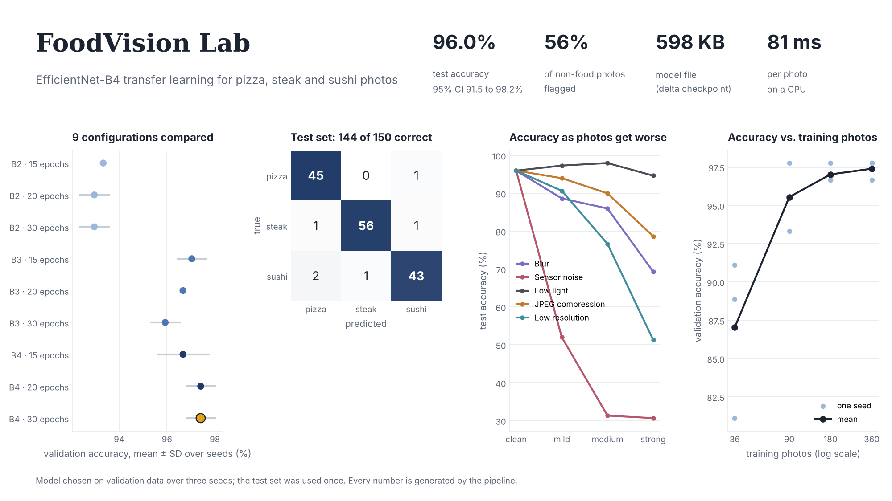
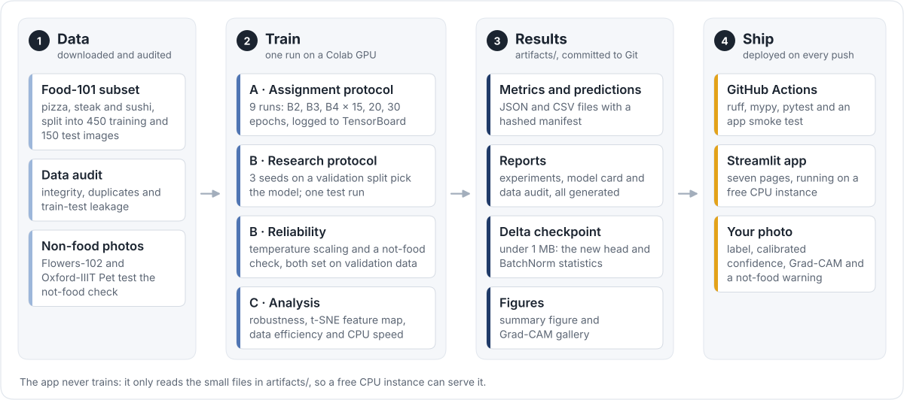

<div align="center">

# FoodVision Lab

**Explainable transfer learning for food photos, from a rigorous experiment to a deployed app.**

[](https://foodvision-lab.streamlit.app/)
[](https://github.com/AnushGoel/foodvision-lab/actions/workflows/ci.yml)
[](pyproject.toml)
[](https://pytorch.org/)
[](https://github.com/astral-sh/ruff)
[](LICENSE)

**[Try the live app](https://foodvision-lab.streamlit.app/)** · [Experiments report](artifacts/reports/EXPERIMENTS.md) ·
[Model card](artifacts/reports/MODEL_CARD.md) · [Methodology](docs/METHODOLOGY.md)

</div>

<br>



<!-- App screenshots: save them as docs/screenshots/predict.png and docs/screenshots/overview.png, then remove these comment markers.
<p align="center">
  
  
</p>
-->

## Overview

FoodVision Lab benchmarks EfficientNet-B2, B3 and B4 as frozen ImageNet feature extractors on the pizza, steak and
sushi subset of Food-101, and serves the selected model in a [Streamlit app](https://foodvision-lab.streamlit.app/). It starts from a graduate
course assignment (nine configurations tracked in TensorBoard) and adds what a trustworthy evaluation needs: model
selection on validation data, one confirmatory test with intervals and significance tests, calibrated
probabilities, a check for photos that aren't pizza, steak or sushi, robustness and data-efficiency studies, and
Grad-CAM explanations.

## Results at a glance

<!-- results:start -->
| Result | Value |
| --- | --- |
| Selected model | EfficientNet-B4, 30 epochs, chosen on validation data over 3 seeds |
| Test accuracy | 96.0% (144 of 150), 95% CI 91.5% to 98.2% |
| Macro-F1 | 95.9% |
| Calibration error (ECE) | 0.132 before and 0.020 after temperature scaling |
| Not-food check | AUROC 0.926; flags 56% of non-food photos and keeps 95% of food photos |
| Model file | 598 KB delta checkpoint; 81 ms per photo on a CPU |

<sub>Generated from `artifacts/` by `python -m foodvision.reports`; the test suite fails if this table and the results disagree.</sub>
<!-- results:end -->

The original course run (Colab T4) picked its best configuration on the test set, as the assignment required:
EfficientNet-B3 trained for 15 epochs reached 98.0% (147 of 150 images, 95% Wilson interval 94.3% to 99.3%), and
seven of the other eight configurations fell inside that interval. Picking the best of nine test scores flatters
the winner, so protocol B chooses on validation data and uses the test set once; the table above reports that
single evaluation. Every table and per-class result: [EXPERIMENTS.md](artifacts/reports/EXPERIMENTS.md).

## The app

The [live app](https://foodvision-lab.streamlit.app/) reads the committed results and serves the selected model on a CPU, across seven pages:

| Page | What it shows |
| --- | --- |
| Overview | the headline results, the key findings and the shareable summary figure |
| Experiment lab | both protocols side by side, accuracy against training cost, and the significance tests |
| Training curves | loss and accuracy per epoch, the BatchNorm ablation, and accuracy against the number of training photos |
| Errors and diagnostics | a Grad-CAM gallery, every misclassified test image, and a t-SNE map of what the network sees |
| Reliability | confidence of right and wrong answers, answering only when confident, the not-food check, and degraded photos |
| Try the model | upload a photo for calibrated probabilities, a Grad-CAM heat map and a not-food warning |
| Data and methods | the dataset audit, the three architectures, the protocol and statistics, and the model card |

## How it works



Training happens once on a GPU and writes small JSON, CSV and image files plus a *delta* checkpoint: only the new
head and BatchNorm statistics over pinned torchvision weights. The app only reads those files, so it never trains
and runs on a free CPU instance. Details: [docs/ARCHITECTURE.md](docs/ARCHITECTURE.md).

| Protocol | Selection uses | Purpose |
| --- | --- | --- |
| A. Assignment | test set (as the assignment specifies) | reproduce the nine-scenario comparison with TensorBoard tracking |
| B. Research | stratified validation split, 3 seeds | unbiased selection, then one confirmatory test evaluation |
| C. Analysis | the saved model, reloaded as the app loads it | robustness, feature map and data efficiency of the selected model (exploratory) |
| Not-food check | validation photos plus non-food photos (Flowers-102, Oxford-IIIT Pet) | choose a rejection score and threshold, then test them once |

Methods, formulas and references: [docs/METHODOLOGY.md](docs/METHODOLOGY.md).

## What this project demonstrates

| Area | Evidence in this repository |
| --- | --- |
| Deep learning | Transfer learning with frozen EfficientNets; an ablation showing that frozen weights do not freeze BatchNorm statistics; deterministic tensor caching |
| Experimental design | Two separated protocols, stratified validation split, three seeds, one-time use of the test set, config fingerprints that invalidate stale results |
| Statistics | Wilson and bootstrap intervals, exact McNemar tests with Holm correction, paired bootstrap differences |
| Robustness and data efficiency | Accuracy under five everyday photo corruptions at three strengths; how accuracy grows with the number of training photos (nested subsets, three seeds); a t-SNE map of what the network sees |
| Reliability and explainability | Temperature scaling, expected calibration error, reliability diagrams, an abstention curve, out-of-distribution detection (three scores compared, threshold chosen on validation data), Grad-CAM for a frozen backbone |
| Data quality | Integrity checks, perceptual-hash duplicate screening and train-test leakage detection |
| Responsible AI | A model card in the structure of Mitchell et al. (2019), generated from the results, with out-of-scope uses and known failure cases |
| Software engineering | Typed modular package, a versioned artifact contract, sub-megabyte delta checkpoints verified by reloading them exactly as the app does, validated uploads, 100+ tests |
| MLOps and delivery | GitHub Actions (ruff, mypy, pytest with coverage, live smoke test), pre-commit, Streamlit Community Cloud |

## Quick start

### Run the app locally

```bash
git clone https://github.com/AnushGoel/foodvision-lab.git && cd foodvision-lab
python -m venv .venv && source .venv/bin/activate      # Windows: .venv\Scripts\activate
pip install -r requirements.txt && pip install -e . --no-deps
streamlit run streamlit_app.py
```

### Reproduce the results on a GPU (about 25 minutes on an L4)

1. Open [`notebooks/run_pipeline_colab.ipynb`](notebooks/run_pipeline_colab.ipynb) in Google Colab, choose a GPU
   runtime, and run all cells.
2. Unzip the downloaded `artifacts.zip` into the repository root (replacing `artifacts/`), refresh the README table,
   and commit:

```bash
python -m foodvision.reports        # regenerates "Results at a glance" from artifacts/
git add artifacts README.md && git commit -m "Update pipeline results" && git push
```

Or run locally on any CUDA machine: `pip install -r requirements-train.txt && python -m foodvision.pipeline`.

### Deploy your own copy

1. Fork the repository, sign in at [share.streamlit.io](https://share.streamlit.io) with GitHub, and choose
   **Create app**.
2. Select the fork, its default branch and the main file `streamlit_app.py`; under advanced settings choose
   Python 3.11.
3. Deploy. `requirements.txt` installs CPU-only PyTorch, and every later push redeploys automatically.

### Develop

```bash
pip install -r requirements-dev.txt && pip install -e . --no-deps
pre-commit install            # ruff lint and format on every commit
pre-commit run --all-files    # check the whole repository once
pytest --cov
```

See [docs/TESTING.md](docs/TESTING.md).

## Repository layout

```
├── streamlit_app.py          app entry point (navigation)
├── app_pages/                seven pages: overview, experiments, training, diagnostics, reliability, predict, methods
├── src/foodvision/           the package (see docs/ARCHITECTURE.md for each module)
├── configs/default.yaml      every experimental setting, fingerprinted
├── notebooks/                Colab runner for the GPU pipeline
├── artifacts/                versioned results the app reads (generated)
├── tests/                    pytest suite with synthetic fixtures
├── docs/                     architecture, methodology, dataset card, testing, design, diagrams
└── .github/workflows/ci.yml  continuous integration
```

## Limitations

- Three classes and 150 test photos: a single image moves test accuracy by 0.67 percentage points.
- The not-food check was tested on flowers and pets only, so other foods, such as a burger, can still receive one
  of the three labels.
- Probabilities are calibrated on a small validation split, so treat them as approximate.
- Grad-CAM maps show where the evidence correlates with the prediction, not what caused it.

Food-101 images remain the property of their owners ([docs/DATASET_CARD.md](docs/DATASET_CARD.md)).

## Citation and license

Built by [Anush Goel](https://github.com/AnushGoel). To cite the project, see [CITATION.cff](CITATION.cff); the
code is released under the [MIT License](LICENSE). Made with PyTorch, torchvision and Streamlit; EfficientNet by
Tan and Le (2019); Food-101 by Bossard et al. (2014).
