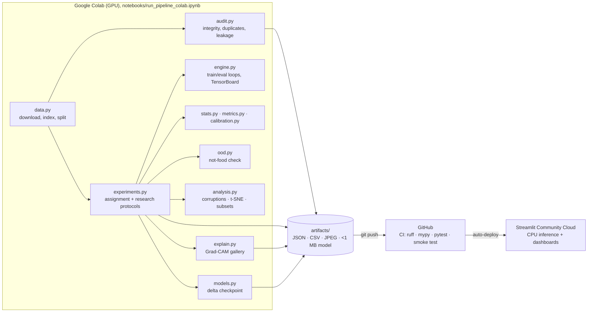

# Architecture

FoodVision Lab separates **training** (GPU, run occasionally) from **serving** (CPU, always on). The two meet at a
small, versioned contract: the `artifacts/` folder. The app never trains, never downloads the dataset, and only
loads the one model it serves.

## Module responsibilities

| Module | Responsibility | Needs PyTorch |
| --- | --- | --- |
| `config.py` | Typed YAML configuration, unknown-key rejection, per-section fingerprints | no |
| `data.py` | Resilient download (mirrors, retries, manual zip), non-food photo download, indexing, stratified split, tensor caching | lazily |
| `audit.py` | Integrity, geometry, formats, exact/near duplicates (difference hash), cross-split leakage | no |
| `models.py` | Model registry with pinned weights, frozen backbone + new head, BatchNorm mode, delta checkpoints, measured architecture summary | yes |
| `engine.py` | Training/evaluation loops, per-epoch TensorBoard scalars, in-training snapshots | yes |
| `experiments.py` | Assignment protocol, research protocol, not-food check, robustness evaluation, feature extraction, data-efficiency runs, Grad-CAM gallery, latency benchmark | yes |
| `metrics.py` | Confusion matrix, per-class precision/recall/F1, macro- and weighted-F1 | no |
| `stats.py` | Wilson and bootstrap intervals, paired bootstrap, exact McNemar, Holm correction | no |
| `calibration.py` | Temperature scaling, ECE, reliability bins, Brier score, abstention curve | no |
| `analysis.py` | Photo corruptions for the robustness test, nested stratified subsets, PCA + t-SNE projection | no |
| `figures.py` | Static 16:9 summary figure (PNG) for the README and social posts, drawn from the artifacts | no |
| `tokens.py` | Design tokens (colours) shared by the interactive charts and the static figure | no |
| `ood.py` | Not-food check: three out-of-distribution scores, AUROC with bootstrap interval, validation-chosen threshold, reproducible non-food sampling | no |
| `explain.py` | Grad-CAM for a frozen backbone, heat-map overlays | yes |
| `imageio.py` | Validation of uploaded bytes (size, format, corruption, orientation, transparency) | no |
| `inference.py` | `Predictor`: one checkpoint, temperature-scaled probabilities, the stored not-food threshold, abstention, Grad-CAM | yes |
| `artifacts.py` | The artifact contract: file names, schema version, atomic JSON/CSV writes | no |
| `reports.py` | Model card (Mitchell et al., 2019 structure), experiments summary and data audit, generated from artifacts | no |
| `viz.py` / `ui.py` | Plotly figure factories and Streamlit helpers shared by the pages | no |
| `pipeline.py` | CLI orchestration (audit, assignment, research, analysis, benchmark), stage caching by config fingerprint with dependent re-runs, checkpoint reload check, environment capture, manifest | yes |

## Design decisions

**Artifact contract.** Every result the app shows is a file in `artifacts/`, listed in `manifest.json` with its
SHA-256, the producing environment and a schema version. The app refuses an incompatible schema instead of
mis-reading it, and every page explains what to run when a file is missing.

**Delta checkpoints.** Freezing the backbone means training changes only the classifier head and the BatchNorm
running statistics. Storing just those (`models.export_delta`) over pinned `IMAGENET1K_V1` weights shrinks a 43 MB
EfficientNet-B3 checkpoint to well under 1 MB, small enough to version in Git. Loading verifies the format and that
the pinned weights match.

**Configuration fingerprints.** Each pipeline stage records a hash of the configuration sections it depends on. A
stage is skipped only when its outputs exist *and* the fingerprint matches, so results produced under an older
configuration are never reused by accident.

**Deterministic tensor caching.** Preprocessing has no random augmentation, so each image is decoded and transformed
once and kept as a tensor. This gives the same numbers as decoding every epoch while removing the CPU bottleneck
that made the original notebook take about an hour on a T4.

**Torch-free core.** Statistics, metrics, calibration, auditing, upload validation and reports have no PyTorch
dependency, so most of the test suite runs in seconds anywhere.

**Thread safety.** The app caches one `Predictor` for all sessions; Grad-CAM registers its hook per call under a
lock so concurrent users cannot interfere.

## App data flow

`streamlit_app.py` registers seven pages with `st.navigation`. Pages read artifacts through `ui.read_json` and
`ui.read_csv`, which are cached by file path and modification time, so a new `git push` of artifacts is picked up
without a code change. *Try the model* validates the upload, loads the cached predictor (downloading the pinned
ImageNet weights on first use), predicts on CPU and draws Grad-CAM.
